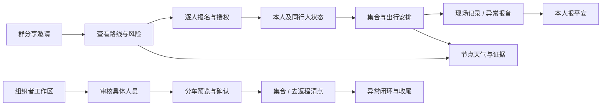

# OurTrail 任务重构研究与第二版结构原型

日期：2026-10-26。代码基线：5af3083。读取时工作区已有 UI 技能及上一版设计文件的未提交改动；本轮未覆盖这些文件。已执行 `git pull --ff-only origin master`，返回 Already up to date。

入口：[任务原型](index.html)。对照：[上一版](../ourtrail-key-pages/index.html)。本轮修改仅在本目录；未修改小程序生产页面、服务端、现有设计技能。

## 1. 对上一版的裁决

**不作为实现依据。** 问题首先是内容和任务模型不完整，其次才是视觉保守。不是把森林绿换成另一种绿色就能解决。

| 发现 | 可复核证据 | 影响与纠正 |
|---|---|---|
| 角色开关只决定报名 / 工作台按钮，参与者缺少真实状态展开 | 旧 index.html `renderActivity`；真 `activity.wxml` 的 rows / selfSheet / nextActionTarget | 参加前讲活动；参加后先讲本人的安排、授权同行人及下一步 |
| 8/12 写成已报名，待审核 3 人与余位没有闭合 | 旧 `renderWorkspace`；`domain/selectors.js:443` 起，occupied=confirmed+pending | 8 已确认 + 3 待审核 = 11 占位，容量 12，剩 1；候补另计 |
| 三人的审核按钮都切换 c1，c2/c3 永远不更新 | 旧 index.html 的 approve 事件 | 点击不能证明任务完成。新版不模拟审核成功，待正式交互切片按 signupId 操作并验证 |
| 时间轴新增“准备”，容易被误当业务阶段 | 旧 renderWorkspace；`utils/journey.js:15` PHASE_ORDER | 保留 published/gathering/active/closing/archived；“行前准备”只能是任务分组 |
| 创建页把结构化风险、确认方式、多上车点等缩掉，反而新增结构化强度选项 | 旧 renderEditor；真 editor.wxml:242、:337 起 | 重排字段，保留契约；强度目前可属于介绍，不能伪造服务端字段 |
| 天气以无数据映射的固定路径图代替生产表达；换日期不改变图 | 旧 weatherChart / renderWeather；真 weather.wxml:45 起 | 保留真实温度、降水、云层海拔、风的同轴关系；本轮用生产渲染器输出合成数据，明确非预报 |
| 页内多个操作只有 toast，且详情子页仍展示根 tab | 旧 click handler / render 中 tabbar 条件；app.json | 原型中区分可交互控件、结构示意与未实现流程；子页用返回路径，根 tab 仅出现在根页 |
| 所谓两套视觉方向主要切换变量，页面骨架完全相同 | 旧 data-theme=forest/sky | 先比较空间结构和任务优先级，再决定色板 |

这是一轮针对关键页的源码审查，并非全库安全审计。17 页完成导航归属盘点；报名、编辑、活动、工作台、天气及三类工作面板做了模板/关键逻辑核对。其余页只做职责与入口检查，不宣称逐行审计。

## 2. 公开竞品研究

访问日期均为 2026-10-26。证据等级：官方公开页面/官方帮助文档；浏览器自动读取超时，未完成登录态原生 App 的逐屏操作。以下是从已读资料得出的设计推论，不能当作对其全部产品体验的评价。

| 产品与出处 | 已核实的产品方法 | 在 OurTrail 中怎么用 | 不照搬什么 |
|---|---|---|---|
| [Partiful 在线 RSVP](https://partiful.com/invitations/online-rsvp) | 活动邀请页、分享、回复跟踪和组织者名单围绕同一个活动展开 | 将邀请页作为群分享落点，随后切换到本人安排；组织者进入专用处理界面 | 一键 RSVP 不能替代本项目逐人资料与授权；不复制公开宾客名单或短信能力 |
| [komoot 高级规划](https://support.komoot.com/hc/en-us/articles/10268757747738-Advanced-route-planning) | 自定义具名节点与地图、节点时间线关联；非道路段明确标示 | 节点编辑有路线上下文，保留 GPX 高程/时间出处；路线节点与交通上车点分开 | 不假造自动寻路、语音导航、路况数据库或持续定位 |
| [AllTrails 官方功能页](https://www.alltrails.com/welcome) | 路线专属条件入口，规划与在途使用各有目标 | 活动路线 → 具体节点天气；天气查询保留路线和抵达时间上下文 | 不添加泥泞、积雪、结冰预测等仓库没有的数据，也不以营销图证明可实现 |
| [两步路活动页](https://www.2bulu.com/event/event_new_list_index.htm?sourceType=2) | 按天数、出发日期、地点、类型等组织活动发现 | 后续发现页评估按出行条件找活动，而非只有品牌卡片 | 不搬交易、保险、商业领队和大规模公开招募；新增筛选先核实 discover 接口 |

Windy 的官方 location forecast 文章搜索可发现，但正文请求连续超时，本轮不将其作为已完成的详细研究证据。进一步视觉研究应补上：komoot 实际节点编辑、Partiful 组织者名单、AllTrails 路线详情的手机截图和操作记录。没有这些证据，不宣称“竞品已充分调研”。

## 3. 从代码重新认识产品

真正的核心对象不是卡片，而是「活动、每个人的报名、每个人的出行义务、车辆每一程、现场证据、通知记录、天气地点/时刻」。

- `domain/selectors.js:36` activityView：时间、截止、容量、确认方式、开放报名、路线快照、多个上车点、风险、装备、费用与取消说明。
- `selectors.js:112` rowView：signupId/groupId、tripMode、已签到、去/返程上车、去向、到家；needsSeatAssignment 等义务标志由领域层给出，不从车名或座位文本猜。
- `selectors.js:420` 起：可见人员随 organizer/staff/vehicle/participant 不同；参与者不是全体名单。角色按钮不得扩大权限。
- `selectors.js:443` 起：confirmed/pending/occupied/remaining、selfTravel/vehicleTravel/assigned/unassigned 口径分开。
- `utils/journey.js`：participantNext、leaderQueue 等翻译现有状态与下一步，设计应消费同一结果。
- `pages/editor/editor.js:800` 起：发布时明确是否本人参加、资料授权和出行方式。创建活动不等于报名。
- `pages/signup/signup.wxml`：每位参与者独立资料、出行方式和同意项；同行人额外代理授权。
- `components/transport-panel`：合法容量、司机、禁用座位、服务上车点、同车约束、预览后提交、交换与移除。不能只画“1 号车 4 座”。
- `components/field-panel` / `pages/vehicle`：签到与去程上车是不同事实；去程、返程、到家和异常闭环不能缩成一个完成勾。
- `pages/notices`：站内发布、已读、外部发送记录三者不能合并为“已送达”。
- `pages/weather`：路线 / 单点、日期、24/48/72h、逐时事实、垂直云层、沿线时空、天文时间轴、条件判断、证据回跳、逐时明细；不是普通天气卡集合。
- `utils/api.js:124` 起：提交结果未知或冲突需重读。UI 成功态不能在点击当下先乐观写死。

读取了 testing/release-coverage-matrix 与 concurrency-consistency-model；二者是历史报告，不能把其中已修复问题当当前缺陷。本轮状态/错误建议以当前 api.js 和页面逻辑为准。

## 4. 目标信息架构：大幅重排职责，保留数据边界

四个根入口暂保留，文字提议「同行 / 天气 / 通知 / 我的」。理由不是沿用旧版，而是四种独立、已存在的任务：跟进活动、独立查天气、处理通知、维护可复用资料。删通知或天气根入口会增加绕行，应先有使用证据。

| 注册页面 | 新职责 / 入口 / 返回 |
|---|---|
| home | 本人最近的同行安排；有权限的组织/协作入口。跨活动精确待办若现有 home 投影没有，不假设免费可得 |
| discover | 从 home 次级入口进入；搜索/选活动后到 activity，返回保留搜索 |
| activity | 分享深链落点；未报名是活动邀请，报名后是个人出行；返回来源页，独立深链返回 home |
| signup | 从 activity 进入；逐人选择、补资料、出行与授权；成功返回 activity 并重读，失败保留输入 |
| editor | home 发起 / 工作台编辑；计划目录取代固定三步长表单，原有五类内容保留；预览进入 activity |
| workspace | 组织者工作区；当前任务直接到相关名单、车辆、现场分区，活动进程移入上下文工具区 |
| staff | 受授权人员范围内的现场执行；由 home 任务入口进入，权限失效给出返回路径 |
| vehicle | 本车去返程清点与发车/完成；不并入全体组织者工作区 |
| weather-hub | 观察点与轨迹组管理、自由查询入口；仍是根 Tab |
| weather | 独立点/路线节点的统一读图工作区；查询参数保留，返回来源上下文 |
| weather-chart | 全屏专业图；从 weather 进入，返回恢复点/日期/选时 |
| notices | 跨活动通知收件箱；打开 activity，返回保留列表位置 |
| anotices | 单活动通知管理；workspace 进入，受众/发布/记录保持独立 |
| me | 本人资料、同行人、隐私与位置共享管理；不堆叠活动工作区 |
| privacy | 从 me 或授权说明进入；保留返回路径 |
| lab | 私有预演工具，不进入普通用户导航 |
| cloud-field-poc | 技术验证页，不进入普通用户导航 |

不以改页面文件数量衡量重构。重点是 activity 的角色/阶段适配、workspace 的操作结构、editor 的内容组织、weather 的阅读方式发生实质变化；旧深链和服务端权限仍兼容。

## 5. 关键路径与状态

| 任务 | 成功后果 | 失败/返回与验收 |
|---|---|---|
| 报名 | 每人分别出现 pending/confirmed/waitlisted 等真实状态 | 缺项定位本人字段；容量变化重新显示名额；授权不预勾；取消保留草稿语义 |
| 审核 | 指定 signupId 更新；人数与队列同步 | busy 禁止重复提交；驳回等所需说明不能省；冲突刷新后重确认；列表筛选与位置保留 |
| 分车 | 具体人员有车辆/座位；待安排人数只算需要乘车者 | 容量/司机/上车点不符给具体原因；计划过期重算；不直接画“全部已安排” |
| 现场 | 签到、去向、上车、到家各自有证据 | 无授权退出；每程分别清点；报备不是完成；不能一键替全体报平安 |
| 天气 | 同一地点/日期/时长的图表与读数一致 | 无坐标给返回修改入口；缺高程保留不确定性；数据失败不显示晴天；excluded 沉默说明、unknown 保留缺项说明 |
| 编辑发布 | 云端草稿/本机修改状态明确；发布后到活动 | 草稿保存失败不得说已同步；缺字段回具体分区；预览不发布；不改变规则只重排界面 |

新原型只验证结构与场景阅读：出行四场景切换、详情展开和页间锚点。没有假装实现上述业务提交闭环。

## 6. 视觉方向与原生映射

比较了两种结构方向：

1. **路线地图优先**：活动和天气以地图占据半屏。适合选路线，但日常查看上车点、审核、收尾时地图会挤压操作，而且无轨迹/坐标的活动会退化为空壳。
2. **任务优先，地图嵌入上下文（本原型）**：邀请页展示路线；已报名后突出集合时刻；组织页用列表；天气保留专业图；编辑器用可回跳的目录。不同页面不套同一种卡片骨架。

建议以第二种继续。视觉采用白底、深墨正文、锈橙行动强调、蓝色事实/天气辅助，取消深绿大 hero、嫩叶高亮与反复卡片包裹。颜色是待评审提案，尚未改生产 token。

| 旧资产 | 新提案 | 原生实现 |
|---|---|---|
| 全局 forest/leaf 品牌强调 | ink + action rust #A83D17；白底 | app.wxss token 系统统一迁移；不能全局替换所有含绿字面量 |
| 每区 card | 分隔线、列表、少量任务强调块 | view / text；为复杂图表和弹层保留容器 |
| 大标题 + 营销副标题 | 实际活动名 / 集合时刻 / 待处理任务 | journey 输出仍单源；不得页面另造业务状态 |
| 三步表单 | 分区目录 + 具名字段回跳 | 原生 scroll-view / 普通表单；不依赖浏览器 details |
| 宽泛的工作台总览 | 分区内直接处理人员 | 复用面板数据/授权；切换不卸载以保留筛选 |
| 装饰性天气曲线 | 原生产图与证据联动 | 继续 SVG/canvas 和现有坐标映射 |

正文建议 15–16px，辅助 12–13px；行操作触控至少 44px；正文颜色与背景需测对比度。锈橙只用于行动/当前选择，不取代警告红或天气色。天气图的业务语义色保留，后续改色需同步画布与图例。底栏安全区、原生导航、组件样式隔离遵守已验证的平台限制。

## 7. 分期交付与验收

1. **设计研究补强**：补竞品手机截图/任务实测，使用真实生产形状样例覆盖长标题、多人报名、缺坐标、权限撤回。接受/调整本轮信息架构。
2. **邀请—报名—我的出行**：先迁 activity/signup/home 的相关入口；按未报名/待审/候补/自行/乘车/集合/收尾/取消/归档验收。回退点是旧页面布局，数据契约不变。
3. **组织工作区**：名单、分车、现场、车辆分阶段迁移；审核的目标人、数字变化、同步、授权、失败恢复逐条真实操作验证。
4. **创建与编辑**：目录/草稿/导入/多点/风险/本人参加；先验证保存恢复，再发布。
5. **天气工作区**：先控制区与阅读层级，后图上联动；保持判据不变，按真实图元和开发者工具像素核验。其余页跟随公共组件迁移。

生产实现前需评审目标结构；这是项目 ourtrail-ui 工作流的设计阶段要求。本轮已形成可评审方案，并非因为该要求而停止源码审查或原型工作。

## 8. 本轮验证与局限

- generate-weather.cjs 实际调用生产 buildUnified/renderUnifiedBase，生成 weather.svg。数据为合成夹具，不是天气服务返回；不产生天相概率或出行许可。
- HTML 脚本语法、链接/资源和结构检查见 verification.txt。
- 原型只读示例数据，不调用生产 API；真实提交、云端、微信真机验证均不在本轮范围。
- 浏览器/原生 UI 检查结果按实际记录，不把静态检查等同于视觉验收。
