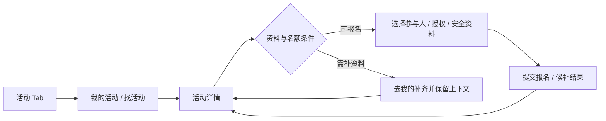
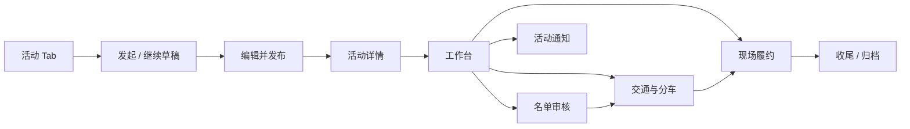
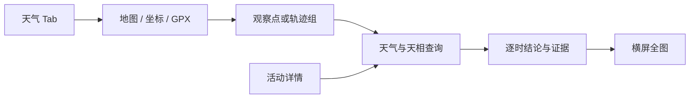
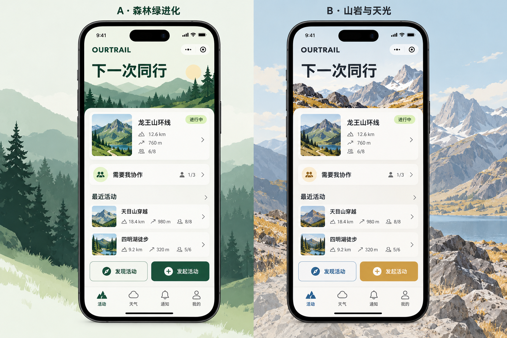

# OurTrail 全站前端重构 · 现状审计与设计提案

> 状态：**设计草案，等待用户审阅后再改小程序页面**  
> 范围：原生微信小程序所有面向用户的页面、导航、交互和视觉；`lab` / `cloud-field-poc` 只盘点，不投入改造。  
> 保留：现有业务能力、服务端授权、状态机、读写和并发契约；技术栈维持 WXML/WXSS/CommonJS。  
> 基线：2026-10-26 当前工作区。页面清单以 `miniprogram/app.json` 为准。

## 1. 结论摘要

OurTrail 当前有 **17 个已注册路由**、四个 Tab 入口和多角色活动履约闭环。建议这次改造按“用户任务”而非单页逐个美化来组织：先统一导航和基础视觉/交互语言，再分别完成参与者报名、组织者履约、天气查询、身份与消息几条完整旅程。

导航提案暂时保留四个一级目的地（活动、天气、通知、我的），重新设计各自职责、入口层级与跨页返回；理由是它们代表四个不同且可复访的任务。设计审阅时可以再比较三 Tab 方案，判断通知是否适合并入活动，而不先删掉独立入口。

视觉提案将并行比较两条路线：

1. **森林绿进化**：保留森林绿/嫩叶绿作为识别点，重新整理纸面底、层级、信息密度、卡片使用和高频操作。
2. **山岩与天光**：采用石色/深墨中性色与更明亮的高山绿、天空蓝或日光色作为新品牌方向；天气图表中的数据语义色单独保护，不随品牌色随意漂移。

两种方向都需要落到相同的首页、活动详情、工作台和天气页面结构上，才能公平比较。当前开发者工具处于未登录的欢迎页，未能取得本轮小程序运行截图；本草案据代码与历史资料建立，最终视觉方向须用真实渲染继续核验。

## 2. 证据、文档与边界

### 已核实的当前结构

- `miniprogram/app.json` 实际注册 17 页；首页、天气 Hub、通知、我的为四个自定义 Tab 根页。
- 产品核心是熟人圈子的户外同行履约：发起活动、分享、报名、审核、交通安排、现场执行、结束收尾。
- V1 角色包括参与者、组织者、协作人员和车辆联系人；同一个人可在不同活动中承担不同角色。
- 天气 Hub 是独立入口；天气查询页既承接活动路线，也承接自由观察点/轨迹组；天气全图由单独横屏页承载。
- `notices` 和 `anotices` 共用页面逻辑，分别承载全局与活动范围通知；`staff` 是现场协作视角入口，`vehicle` 是车辆联系人任务页。
- `lab` 是白名单限制的全流程预演工具；`cloud-field-poc` 自述为非生产 SVG 性能验证。按用户决定，这两页只留在审计清单，不做视觉改造。
- `privacy` 是用户可达的隐私说明页；`weather-chart` 是产品页面，不属于内部工具。

### 页面分组与当前职责

| 旅程/分组 | 页面 | 当前职责与设计重点 |
|---|---|---|
| 活动入口 | `home`、`discover` | 我的活动、协作任务、发起、搜索与发现；首页需快速区分“继续处理”和“找新活动” |
| 活动参与 | `activity`、`signup` | 活动详情与身份相关操作；多人整组报名、逐人资料/授权、容量与候补说明 |
| 活动创建 | `editor` | 草稿、路线/集合、时间、风险与发布；降低长表单的认知负担，同时保留草稿和字段校验契约 |
| 组织者履约 | `workspace` + `roster-panel` / `transport-panel` / `field-panel` | 待办、阶段门、名单、分车、现场；减少高频操作的点击与等待，保留阶段和每行事实门控 |
| 协作角色 | `staff`、`vehicle` | 从任务入口进入自己的责任范围；避免要求用户理解内部角色模型或手填内部 ID |
| 通知 | `notices`、`anotices` | 全局消息记录、活动通知发布与投递状态；共享 UI 规则，但上下文与收件范围要清楚 |
| 独立天气 | `weather-hub`、`weather`、`weather-chart` | 地图/经纬度/GPX 入口，观察点与轨迹组，统一天气与天相查询，横屏全图；专业图表需要单独信息层级 |
| 个人与合规 | `me`、`privacy` | 身份、常用同行人、安全资料、协作码、位置授权；隐私指引说明资料用途和撤回方式 |
| 内部/实验（不改造） | `lab`、`cloud-field-poc` | 仅登记用途、入口与白名单/编译模式；未来代码改变如有需要再单独提案 |

`anotices`、`weather-chart`、`privacy` 没有通用页头标题不是删页理由；它们的导航上下文、系统导航栏和返回语义要在逐页核验中单独确认。

### 逐路由清点与改造归属

下表是基于路由、源码入口和已有产品文档的**初始归属**，不是已完成的页面级视觉审查。每页还要在设计阶段补齐状态、内容层级、组件消费和真机基线。

| 路由 | 面向对象 / 当前入口 | 重构方向 | 阶段 |
|---|---|---|---|
| `pages/home/home` | 全局活动 Tab；参与者、组织者、受邀协作人 | 活动任务中心；强化“继续我的活动 / 我需要处理 / 找活动 / 发起”分层 | 2 |
| `pages/notices/notices` | 全局通知 Tab | 全局收件箱与阅读/投递记录；通知优先级、未读状态、活动归属需复核 | 3 |
| `pages/me/me` | 我的 Tab | Identity Hub；参考既有 Profile 设计包，重审版式与全局视觉一致性 | 5 |
| `pages/activity/activity` | 首页、发现、分享/深链 | 角色/阶段相关的活动详情与主操作；路线、风险、报名、天气、组织者入口分层 | 2 |
| `pages/discover/discover` | 活动页次级入口 | 只读发现与适配筛选；从卡片到活动详情的决策信息和安全说明 | 2 |
| `pages/signup/signup` | 活动详情、分享/深链 | 多人整组报名流；参与人选择、资料、同意、出行方式、候补结果分步且减少往返 | 2 |
| `pages/editor/editor` | 活动 Tab、详情/工作台编辑入口 | 长表单重组为清晰阶段；草稿、路线/时间、风险与发布前校验保持可见且可恢复 | 2 |
| `pages/workspace/workspace` | 组织者从活动详情进入 | 组织者履约工作台；阶段、阻塞和名单/交通/现场/通知分区联动 | 3 |
| `pages/staff/staff` | 首页协作任务深链 | 现场协作人专属任务面；只呈现获授权的现场操作与解释 | 3 |
| `pages/vehicle/vehicle` | 首页或车辆任务深链 | 车辆联系人专属视图；明确车辆、名单、上下车/完成状态与缺参恢复 | 3 |
| `pages/weather/weather-hub` | 天气 Tab | 天气任务入口与观察对象管理；地图/坐标/GPX 三种入口建立清楚优先级 | 4 |
| `pages/weather/weather` | 天气 Hub 或活动详情 | 统一查询页；区分活动上下文与自由查询，突出结论依据、路线节点和时间窗口 | 4 |
| `pages/weather-chart/weather-chart` | 天气查询页 | 横屏时间图；图例、游标、天相窗口和返回路径在窄设备/横屏单独校验 | 4 |
| `pages/anotices/anotices` | 活动详情/工作台/天气页 | 活动范围通知发布与记录；复用全局通知视觉语言但保留活动上下文 | 3 |
| `pages/privacy/privacy` | 我的页 | 隐私说明与授权方式；用途、展示范围、撤回和平台权限边界易读 | 5 |
| `pages/lab/lab` | 仅开发者编译模式/白名单 | 内部预演工具；只记录、不重构 | 不改 |
| `pages/cloud-field-poc/cloud-field-poc` | 实验/编译模式 | SVG 性能验证 POC；只记录、不重构 | 不改 |

### 既有设计资料如何使用

- `docs/product/交互审查-2026-09-30-全站问题清单.md` 包含高点击成本、状态反馈、键盘遮挡、跨分区刷新等历史问题和当日修复记录。该审计是静态/历史快照；本轮只将其作为复查清单，不声称所有问题今天仍存在。
- `docs/product/profile/` 已包含“我的”页重设计的详细设计包。其业务语义、安全边界和数据模型可作为基线；其 token、页面布局和实现细节仍需接受本次全局设计系统评估。
- `docs/product/天气模块升级-P2/P3/P4*` 与 `docs/weather-ux/architecture/` 保存天气模块的平台边界、图表和数据语义。天气专项视觉/交互需保持已有天相判据和图表事实一致。
- `docs/prototypes/ourtrail-app` 是冻结的 React 参考原型，不作为生产技术栈或现行视觉定稿。
- `wechat-miniapp-engineering-skill` 的页面图可以辅助定位；本次扫描误判项目业务类型，因此只采纳 `app.json` 路由和文件关系，所有设计结论回源码与产品文档验证。

### 本轮不触碰的边界

- 不改云函数、数据库、授权策略、服务端投影、领域状态和数据结构。
- 不引入 React、Taro、uni-app、Tailwind、构建系统或生产 npm 依赖。
- 不删功能或页面；若发现冗余、死入口或不合理流程，先在方案中列证据和影响，由用户裁决。
- 不投入时间改造 `lab`、`cloud-field-poc`。

## 3. 核心用户任务与旅程

### 参与者：找到并加入一场合适的活动



重点：主 CTA 要随活动状态与当前角色解释“现在能做什么”；报名完成或被拒绝后有明确结果和返回活动详情的路径；资料、代报名授权、候补与出行方式差异不能被视觉简化成同一状态。

### 组织者：发起并完成活动履约



重点：工作台应将“当前阶段、阻塞事项、下一步”与四个业务分区连起来；高频、无歧义操作应尽量减少逐人输入和整区等待；危险/影响他人的操作保留明确确认。历史“成本乘法”问题逐项重验后再决定交互方案。

### 协作人员与车辆联系人：从任务直达责任

协作入口应携带已知活动上下文，落到受授权的任务；车辆联系人直达具体车辆/名单。缺少参数、权限过期或任务已结束时展示原因与可行去向，不能给用户内部字段名或不可恢复的空页面。

### 天气用户：从地点/路线得到可解释的环境信息



重点：活动天气与自由查询共用查询体验，但入口上下文、保存/分享和抵达日程保持正确；图表、逐节点路线和天相结论要按真实证据表达，不用颜色单独承载判断。

## 4. 导航方案候选

### 推荐方案：保留四个一级目的地，重新定义职责

| Tab | 建议职责 | 根页首屏优先级 |
|---|---|---|
| 活动 | 我的待办/活动列表 + 发现/发起入口 | 正在进行、需要我处理、最近活动；发现与发起是次级但清晰入口 |
| 天气 | 自由天气查询与观察点/轨迹组管理 | 继续上次查询、地图选点/导入路线、最近观察对象 |
| 通知 | 全局通知与阅读/投递记录 | 未读与最近消息；发布入口仅对有权限角色显示 |
| 我的 | 身份与资料、安全资料、协作身份、隐私授权入口 | 当前身份/需要补全、活动摘要与常用同行人 |

选择理由：四个入口对应的用户意图明显不同；天气是产品独立能力，通知是无聊天系统情况下的结构化消息入口，“我的”已有丰富身份/安全能力。避免把 `anotices` 与全局通知的活动上下文混在一个无差别列表中。

### 备选方案：三个 Tab，将通知纳入活动入口

`活动 / 天气 / 我的`，把全局通知改为活动页中的消息入口或首页提示。优点是一级导航更短；风险是跨活动消息、投递记录和未读状态更难被发现，且可能让活动入口承载太多组织者任务。

**建议先拿低保真结构稿比较，不提前删除通知 Tab。** 若访谈/使用数据表明通知不是独立高频目的地，再评估三 Tab。

## 5. 页面级方向草图（待在视觉/交互稿中细化）

### 活动 Tab

```text
顶部：当前身份语境 + 轻量个人入口
主区：需要我处理 / 正在进行（仅有内容时）
活动列表：近期 / 我发起 / 我参与 / 协作任务（筛选方式待重排）
次级入口：发现活动、发起活动
底部：四个 Tab
```

原则：让已加入活动与组织者待办先于空泛欢迎语；空状态给一个明确起步动作；不在同一首屏放多个同等强度的主按钮。

### 活动详情

```text
活动名称 + 当前状态 + 随角色/阶段变化的主操作
时间 / 地点 / 集合 / 路线 / 风险装备（先呈现决策所需摘要）
报名与出行状态 / 名单摘要（依权限展示）
天气与天相、通知、组织者工作台等上下文入口
```

原则：继续保留按角色和阶段变化的首屏主操作；详细履约数据渐进展开；敏感资料只在授权范围和活动时间窗内出现。

### 工作台

```text
活动标题 + 阶段状态 + 下一步/阻塞说明
关键待办（可直达相关业务分区）
名单 | 交通 | 现场 | 通知（分区标签/路由形态待实测）
阶段流程与推进操作（危险操作说明清楚）
```

原则：跨分区状态可见，数据刷新不让整页无故闪回 loading；分区操作后回到用户刚才的上下文。

### 天气 Tab / 查询

```text
天气 Tab：选点、最近观察对象、导入/管理轨迹
查询页：查询地点与时段 → 结论摘要 → 指标/剖面 → 逐节点行程
全图：横屏图表、时间游标与图例
```

原则：先回答“当前地点/路线值得注意什么”，随后给证据；结论、图例与图形标记同源；无数据、缺海拔和不确定性清楚表达。

## 6. 视觉方向对照

两条路线必须使用相同内容和页面骨架制作对照，不将文案、数据或信息量差异误当作色彩差异。



概念板用于比较气质和色彩，不是生产页面截图或像素规格；其中示例活动名、背景插画和内容仅作占位。实际页面需要按代码中的真实数据、平台控件、滚动/键盘行为与真机证据重画。

| 维度 | A · 森林绿进化 | B · 山岩与天光 |
|---|---|---|
| 品牌锚点 | 森林绿 + 嫩叶绿，保留当前熟悉度 | 石墨/岩灰中性色 + 高山绿；天空蓝/日光琥珀作为有限强调 |
| 页面底色 | 纸面暖灰白，卡片更克制 | 更中性的浅岩色；深色只用于少量身份/图表强对比区域 |
| 视觉气质 | 可信、亲近、适合熟人协作 | 清晰、专业、户外装备感更强 |
| 重点风险 | 仍像旧 UI，只换 token；卡片堆叠问题未解 | 过度技术化、色彩竞争、与天气语义色冲突 |
| 必须守住 | 语义文字、可读性、低噪声 | 同左；新色必须测对比并与数据颜色解耦 |

方案建议：以信息层级、留白、字体尺度、操作密度和状态表达形成视觉差异；不以“多加渐变/阴影/插画”充当彻底重构。天气图表的标记色、云量色带、风险色等由数据语义控制，需在图表专项验证后才能迁移。

## 7. 共用设计系统提案

现有组件与 token 需要逐个分类，而不是一律复用或推倒重来：

1. **保留并验证的平台基础**：样式隔离、TabBar 安全区、弹层可命中/关闭态、原生 picker/地图/canvas 行为、分享与隐私授权。
2. **保留业务语义的领域组件**：名单行、车辆座位、现场任务、活动卡、天气剖面/图表、通知记录。
3. **重评通用基础件**：按钮、卡片、分段控件、表单字段、状态面板、弹层、person-row、icon；统一组件职责、变体、忙碌/聚焦/禁用/错误状态。
4. **重整页面模板**：Tab 根页、详情页、编辑表单、任务工作台、数据图表页、受限/隐私页。模板服务于任务，不强迫每页套同一标题与卡片布局。
5. **维护单一设计源**：颜色、字号、间距、触点、层级与图表数据色映射到 `app.wxss` 和必要的 canvas 色板；淘汰规则需有消费者迁移表。

所有表单、地图、横屏图、动态名单按其原生控件实际能力评估；触控尺寸/键盘避让/对比度通过真实尺寸与设备渲染检查，不能只靠静态规则。

## 8. 建议分期

| 阶段 | 交付 | 依赖/退出条件 |
|---|---|---|
| 0 · 基线与决策 | 页面-组件-任务地图；旧审计项现状复核；两种导航/视觉对照；用户确认 IA 与品牌方向 | 取得主要用户路径的当前渲染证据；差异/待核项单列 |
| 1 · 系统基础 | token、基础组件、TabBar、状态/表单/弹层模式与页面模板 | 组件状态矩阵、截图与原生平台检查过关 |
| 2 · 参与者主链 | 活动首页、发现、活动详情、报名、编辑器 | 从入口发起或报名到明确结果的关键路径成立 |
| 3 · 组织者与协作履约 | 工作台、名单/交通/现场、通知、staff、vehicle | 角色权限、阶段门、并发冲突与操作后返回上下文通过 |
| 4 · 天气与路线表达 | weather-hub、weather、weather-chart、路线/地图/天相组件 | 保留科学语义，横屏、滚动、图例与缺失数据渲染验证通过 |
| 5 · 身份与收尾 | me、privacy；跨页导航/通知状态统一；淘汰临时适配 | 安全/隐私语义、草稿、授权撤回和文案完成核验 |

`lab`、`cloud-field-poc` 每阶段只确认未被误改，不参与视觉验收和重构工时。

## 9. 设计与实现验收

### 设计审阅前

- 每个产品路由有角色、任务、入口和返回路径；内部工具单独标明。
- 关键旅程包含成功、拒绝、空、失败、busy、弱网/冲突等真实状态及恢复动作。
- 页面结构/导航方案标出与现状的差异及迁移影响；后台契约和非目标明确。
- 两个视觉方向用相同内容并排对照；给出组件、token、地图/图表等特殊内容的处理原则。

### 每个实现阶段

- `node tools/check.js` 与 `node tools/check-handlers.js` 通过。
- 相关领域/页面逻辑套件覆盖既有关键契约；不以像素改版为由重写无关领域逻辑。
- 按 `docs/e2e-mp/automation-playbook.md` 使用真实开发者工具渲染/交互证据；每条 UI PASS 有真实操作和后果，环境或覆盖不足记 INCONCLUSIVE。
- 小屏/长文本/键盘/安全区/地图/横屏图表等设备适配记录截图；内部测试页不纳入交付截图。
- 对照已核实的用户任务复走，记录保留项、移除项和回退办法。

## 10. 前置技能组合

- **`ourtrail-ui`（本仓库）**：已扩展为项目约束、全站交互/视觉流程和验收路由；仍须以源码、用户确认和平台实测为准。
- **`wechat-miniapp-engineering-skill`**：只读结构索引与影响分析辅助；扫描器已出现行业误判，不能作为产品设计判断来源。
- **`skill-creator`**：已用于重构 `ourtrail-ui` 并做结构校验。
- **`verification-before-completion`**：每个实现阶段按静态与真机证据报告结果。
- **`test-driven-development` / `systematic-debugging`**：功能行为修改或缺陷排查时按需使用，不强迫纯视觉稿先写无意义测试。
- **`requesting-code-review`**：阶段性交付或合并前审查。
- **`imagegen`**：只有最终视觉方案需要定制插画/纹理素材时再使用；不用于代替原生页面设计或验收。

## 11. 待用户在方案审阅时裁决

1. 导航：推荐保留四个独立目的地，比较后确认是否合并通知入口。
2. 品牌：比较“森林绿进化”与“山岩与天光”，确认主色路线。
3. “我的”专属重设计与本次全局组件/导航规则的冲突项：按用户任务和安全契约复核后决定迁移，不默认采用旧 UI spec。
4. 历史交互审计列出的结构性问题：逐项确认当前是否存在、是否依然符合服务端规则，再排入对应阶段。

**在这四项与页面设计包审阅完成前，不开始批量修改小程序页面。**
